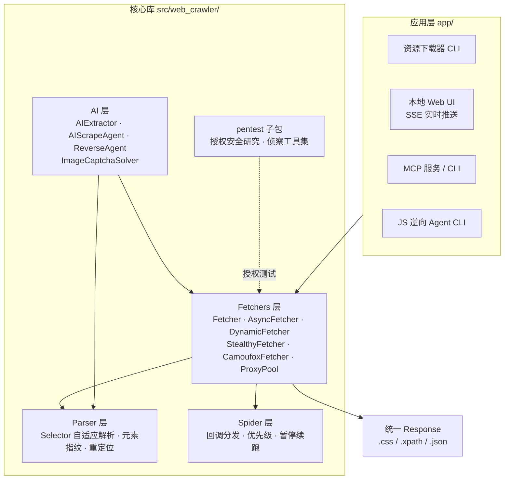
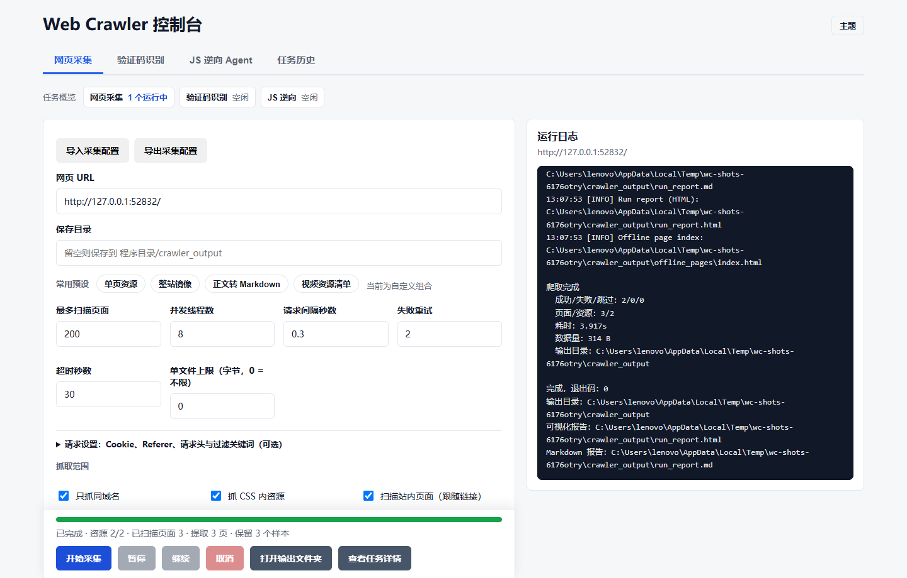
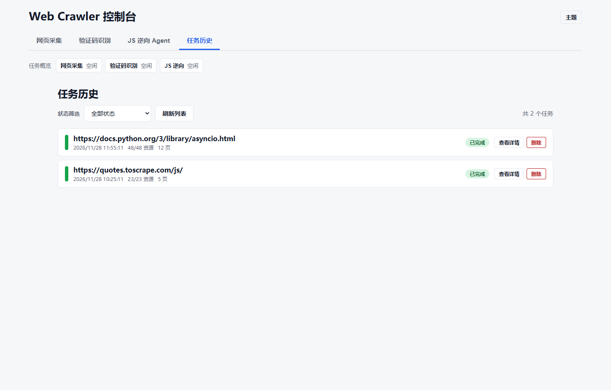
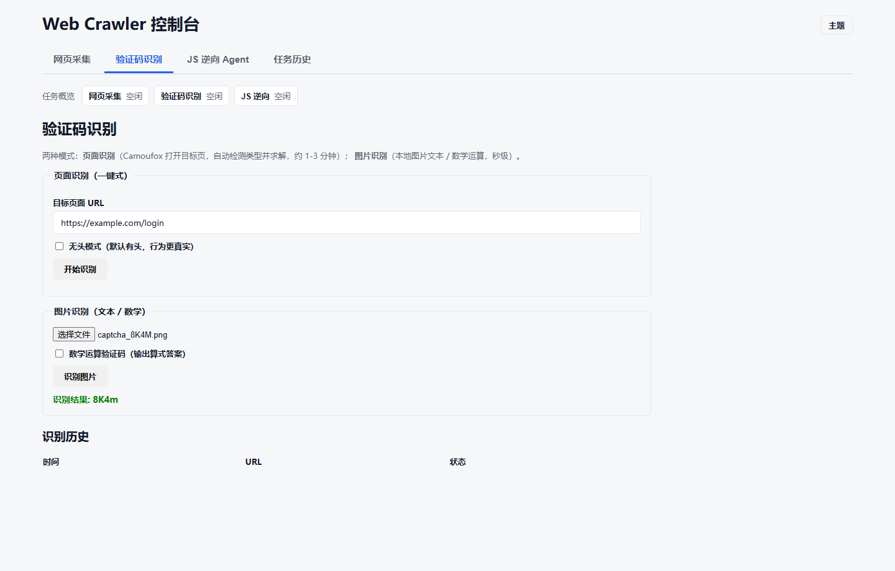
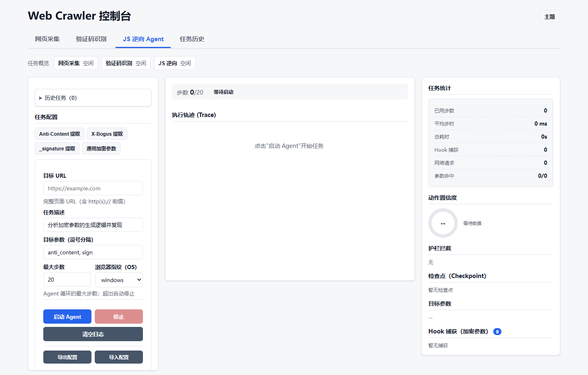

# web-crawler

<p align="center">
  <a href="https://pypi.org/project/stealth-web-crawler/"></a>
  <a href="https://pypi.org/project/stealth-web-crawler/"></a>
  
  
  
  
  <a href="https://codecov.io/gh/xiaomaozjj666/web-crawler"></a>
  <a href="https://xiaomaozjj666.github.io/web-crawler/"></a>
  
</p>

Scrapling 风格的隐身网页爬虫库：**自适应选择器**、**TLS 指纹隐身 HTTP**、**JS 渲染**与**回调式 Spider 框架**，另附一套应用层资源下载器与本地 Web UI。

📖 **完整文档**（架构详解 / API 参考 / 逆向 Agent 手册）：[https://xiaomaozjj666.github.io/web-crawler/](https://xiaomaozjj666.github.io/web-crawler/)

## 最快上手

```bash
pip install "stealth-web-crawler[all]"    # 核心 + TLS 隐身 + JS 渲染；源码安装见「安装与运行」
python -m web_crawler.app.ui --open       # 本地控制台：http://127.0.0.1:8765
```

**Windows 原生桌面程序（推荐，无需开黑框或浏览器）**：在源码目录执行 `.\scripts\build-desktop.ps1` 编译 `desktop-app\Web Crawler.exe`（基于 Windows 内置 WebView2，默认以安全模式启动并保留 SSRF 防护，关闭窗口自动停止本地服务；加 `-DesktopShortcut` 可同步创建桌面快捷方式；仅限个人可信/授权内网环境时支持命令行传入 `--power`，或本机编译时加 `-PowerMode` 设为默认满血模式，运行时仍可用 `--safe` 临时回退安全模式）。

写代码时导入名是 `web_crawler`（发行名是 `stealth-web-crawler`）；抓取 / 解析 / Spider 三段示例见 [快速开始](#快速开始)，Docker 与 MCP 接入见 [安装与运行](#安装与运行)。

## 分层架构



## 界面预览

本地 Web UI（`python -m web_crawler.app.ui`，默认 http://127.0.0.1:8765）：网页采集（图片/JS/视频/文件下载、并发与断点续传）、JS 逆向 Agent、任务历史三个入口，SSE 实时推送进度与日志。表单顶部提供「常用预设」（单页资源 / 整站镜像 / 正文转 Markdown / 视频资源清单），一键勾好一组选项后仍可微调；勾选「只生成清单，不下载文件」后，仅下载阶段生效的选项会置灰并标注「当前不生效」，但不会禁用控件、也不改变提交的字段。

| 网页采集控制台 · 多页抓取与实时运行日志 | 任务详情 · 离线验收与 CSS 字段规则验证 |
| :---: | :---: |
|  |  |
| 验证码识别 · 本地 `ddddocr` 图片 OCR 实测 | JS 逆向 Agent · 预设模板与监控面板 |
|  |  |

> 以上截图可通过 `python scripts/capture_screenshots.py` 一键刷新（自动拉起本机临时演示站完成真实多页抓取、离线验收、CSS 规则验证与本地 `ddddocr` 识别，不污染本地 `crawler_data.db`）。

控制台顶部显示网页采集、验证码识别和 JS 逆向的运行状态。网页采集勾选「智能数据提取」「正文提取」或「正文 Markdown」后，可在任务详情的「页面提取」查看内容（未开启正文提取时，该面板展示 Markdown 原文），并从页面筛选其来源资源。每次任务保存自己的提取结果，复用输出目录后仍可查阅旧任务。磁盘上的正文按主机和页面路径保存到 `extracted_text/`，避免不同页面的同名文件互相覆盖；Markdown 保存到 `extracted_markdown/`。

正文提取保留块级结构（段落/标题/列表项各占一行），并剥离 script/style/nav/footer 等页面骨架与连续重复行——直接可作为 LLM 或人工阅读的分析输入，不再是被压成一整行、混着导航噪音的字符串。可见文本几乎为空的 SSR 页面会自动回退到内嵌 JSON 状态块（`<script type="application/json">` 与 `window.__INITIAL_STATE__ = {...}` 两类形态，覆盖 Next.js / Nuxt / React Router / 字节系 `__MODERN_SERVER_DATA__`），2026-11 实测 docs.trae.ai/solo 与 /solo/skills 从 0 字恢复到 1.8–2.5 万字符。

**结构化 Markdown 输出（对标 firecrawl「网页 → Markdown」）**：`--extract-markdown` 把正文渲染成保留语义标记的 Markdown 并按主机/路径存到 `extracted_markdown/*.md`——标题层级（`#`~`######`）、有序/无序列表（含嵌套缩进）、链接（`[文字](href)`）、强调（`**`/`*`）、行内代码、`<pre>` 代码围栏、表格（MD 表格带分隔行）、引用块（`>`），中文行内拼接沿用纯文本渲染的空格规则（不污染中文、英文相邻片段补空格）；与 `--extract-text` 相互独立，可同时开启。

### 从页面样本到批量提取

1. 在采集表单展开「字段规则与页面样本」，勾选「保留页面样本用于验证」。任务完成后，在「任务详情 → 页面提取」打开「字段规则验证」。验证只处理已保存的 HTML。
2. 输入 CSS 或 XPath 字段规则。可以选择一个页面验证，也可以检查本次全部样本。批量结果显示每个字段的命中与缺失页数，最多列出 30 个可跳转的问题样本。可导出覆盖报告与 `field-rules.json`，也可通过「用于下一次采集」填入表单。
3. 用同一份规则进行命令行提取或生成 Spider。三个入口的结果都包含 `page_url`、`item` 和 `missing_required`。

```json
{"version": 1, "fields": {
  "title": {"css": "title", "required": true},
  "heading": {"xpath": "//h1/text()"},
  "links": {"css": "a::attr(href)", "many": true}
}}
```

```bash
web-crawler --sample saved-page.html --rules field-rules.json --json
web-crawler --url https://example.com/ --rules field-rules.json --out ./out
web-crawler-startproject article_fields --rules field-rules.json
cd article_fields
python main.py https://example.com/ --output items.jsonl
```

`required` 标记必填字段，`many` 返回全部非空匹配。未命中的单值为 `null`，多值为 `[]`。采集器把字段结果写入 `rule_items.jsonl`，并在运行摘要和报告中统计缺必填字段的页面。

采集器的 `rule_report.json` 与生成的 Spider 的 `<输出文件名>.rule-report.json` 使用同样的覆盖报告格式。报告按本次进入字段提取阶段的页面统计，提取错误单独计数。`rule_sha256` 用于核对报告对应的规则内容。

表单的「导出采集配置」保存目标、采集参数和字段规则，可用 `web-crawler --load-config crawl-config.json --out ./out` 运行。也可以把 CLI 的 `--save-config` 产物导入表单。控制台导出的配置省略请求头、本机输出目录和只适用于本机任务的选项。

需要把页面里以 `<a>` 链接的数据文件（CSV / Excel / JSON / Parquet / SQLite）一并下载时，加 `--download-linked-data`（默认关闭，避免把普通链接误当下载任务）。开启后这些数据文件只作为资源下载，不再进入页面队列被当作 HTML 解析。下载后的原始文件可直接交给 data-analysis-agent 等分析工具，GB18030 导出的 CSV 也能被核验链路读取。

`--crawl-pages` 跟随同域页面链接时会校验响应类型：PDF / CSV / ZIP 等非文档响应（以及 `--download-linked-data` 命中的数据文件）不会落成页面、不会做正文/Markdown 抽取，也不会生成离线页；起始 URL 不受此限制。

采集时勾选「离线重写 HTML」，或在 CLI 中使用 `--rewrite-html`。采集完成后，任务详情会显示离线页面数量和目录；可从输出目录里的 `run_report.html` 进入页面索引，也可直接打开 `offline_pages/index.html`。移动结果时保留整个输出目录，已下载的资源和页间链接使用相对路径。未下载的 HTTP(S) 资源仍指向原站。

离线验收从页面索引检查可达的 HTML、CSS 和资源引用（含 `og:image` / `twitter:image` 等 meta 资源与 `prefetch` / `prerender` 等 link 预取）。任务详情与 `run_report.json` / `summary.txt` / `run_report.md` 给出缺失、越界、外部资源和未检查项的计数，`run_report.html` 额外列出最多 20 条示例。归档移到新位置后，可用 `web-crawler --verify-offline ./crawler_output --json` 重新验收。命令读取归档文件，遇到网页 URL 仅做记录。静态检查通过时退出码为 `0`；发现缺失/越界，或只能部分验证（含外部资源、目录引用、站点根路径等）时为 `1`。表单提交、脚本发起的请求与视觉效果不在静态验收范围，需要单独做浏览器实测。

## 功能特性

- **自适应解析器** — `Selector` 基于 `lxml`，支持元素指纹计算与结构相似度重定位：站点改版导致选择器失效时，已保存的指纹会自动在新页面中重新找到对应元素（Scrapling 的标志性能力）。公开 `save` / `retrieve` / `relocate` API 便于显式管理指纹；内置 `find_by_regex`、`re` / `re_first`、`get_all_text`、`prettify`、完整 DOM 遍历（`parent` / `children` / `siblings` / `next` / `previous` / `path`），以及 `ResultList` 批量辅助方法（`css` / `xpath` / `get` / `getall` / `.first` / `.last`）。支持 Scrapling 风格 `::attr(name)` 伪元素直接取属性。
- **隐身 HTTP** — `Fetcher` 通过 `curl_cffi` 重放真实浏览器的 TLS/JA3 指纹与 HTTP/2 帧序，使请求在网络层与 Chrome 难以区分；支持 `impersonate="chrome131"` 等浏览器预设，并可通过 `ja3_fingerprint` 参数透传到 `curl_cffi` 的 `ja3` 参数做细粒度 TLS 扩展定制（`max_redirects` 默认 5，限制重定向跳数）。`curl_cffi` 缺失时自动降级到 `httpx`（带警告）。`AsyncFetcher` 提供纯异步 API；`download()` 提供流式下载（断点续传 + `max_bytes` 上限 + 取消回调，SSRF/DNS 钉扎/代理/会话池校验链全程生效）。
- **懒加载** — `import web_crawler` 不会强制加载 `playwright` / `curl_cffi`，重型子模块在首次访问时才解析（Scrapling 同款模式），仅需解析功能的用户无需安装浏览器依赖。
- **JS 渲染** — `DynamicFetcher` 驱动 Playwright/Chromium 渲染动态页面，支持按资源类型屏蔽、按选择器等待。
- **反爬处理** — `StealthyFetcher` 注入指纹补丁 JS、人类化鼠标/滚动轨迹，并对 Cloudflare 挑战做尽力而为的处理。
- **代理轮换** — `ProxyPool` 支持轮询/随机策略与按代理失败次数冷却。
- **会话池** — `SessionPool` 池化 `curl_cffi` 会话并让 TLS 指纹随会话轮换（round_robin / random），带 LIFO 复用、池上限与临时超额、空闲回收、连续失败淘汰与预热；`Fetcher(session_pool=...)` 一行接入，DNS 钉扎在池化会话上同样生效。
- **Spider 框架** — `Spider` / `Request` 提供回调分发、优先级调度、域名过滤、指纹去重（method+url+body，`DupeFilter` 可插拔）、失败重试（指数退避 + jitter 抖动，`retry_http_status` 响应级业务重试与 `fetcher.retries` 传输层重试两层独立）、可选 `robots.txt` 遵守（含 `Crawl-delay` 遵守与三源延迟取最保守者）、`per_domain_concurrency` 域级并发槽位与基于 JSON 的暂停/续跑；`CacheMiddleware` 提供 GET 响应磁盘缓存（TTL、离线回放、可调存储目录），`AutoThrottle` 基于 EMA 响应延迟做自适应限速（对齐 Scrapy 语义），运行统计可经 `stats_output` 导出 JSON / JSONL（多次运行聚合分析），`feed_output` 一行把抓取结果落盘（JSON 快照 / JSONL 追加 / CSV），`ValidationPipeline` 做 item 结构校验（pydantic 或零依赖 dict schema）；`LinkExtractor`（allow/deny 正则、域白/黑名单、去重保序、URL 规范化）+ `CrawlSpider`（`rules` 规则引擎递归跟随遍历）+ `SitemapSpider`（sitemapindex 递归 + robots `Sitemap:` 行自动发现），对标 Scrapy 同名概念。
- **统一异常体系** — 以 `WebCrawlerError` 为根的异常族（`UnsafeTargetError` / `FetchError` / `ParseError` / `ConfigError` / `InvalidStateError` / `AIProviderError`）：`except WebCrawlerError` 一次捕获库自身的错误，与环境错误精确区分；每个子类同时继承 `ValueError` / `RuntimeError`，既有捕获代码零破坏。
- **统一 `Response`** — 所有 fetcher 返回同一 `Response` 对象，内置 `.css()` / `.xpath()` / `.json()` / `urljoin()` 辅助方法。
- **AI 辅助抓取** — `AIExtractor` 把自然语言字段描述转换为校验过的 CSS 选择器（含自愈能力）；`AIScrapeAgent` 编排抓取与抽取，遵守 `robots.txt`，对 429/503 退避（遵循 `Retry-After`），遇到卡死会返回"转人工处理"。
- **JS 逆向 Agent** — `ReverseAgent` 通过 **观察 → 思考 → 行动** 循环（`CamoufoxFetcher` + DeepSeek-V4.1-Flash）逆向目标站点的加密逻辑：注入 JS Hook（fetch / XHR / cookie / `crypto.subtle` / webpack / console）、捕获网络流量、拆分 webpack 包，再让 LLM 反混淆并在 Python 中重实现签名算法。内置 6 种真实浏览器交互动作（`click` / `type` / `scroll` / `press` / `hover` / `select_option`）、3 种多标签动作（`new_tab` / `switch_tab` / `close_tab`）与人类化输入轨迹；危险点击护栏与选择器注入拦截。同时通过 MCP 服务（`web-crawler-mcp`）、命令行（`web-crawler-reverse`）与 Web UI（SSE 实时推送 `/reverse/stream`）暴露。
- **图片验证码识别** — `ImageCaptchaSolver` 无需浏览器即可识别三类图片挑战：文本 OCR（4–8 位字母数字）、滑块缺口定位（Pillow + numpy 模板匹配）、点选坐标识别（视觉 LLM）。后端按 `ddddocr` → numpy 模板匹配 → LLM Vision 依次降级。`CaptchaManager` 在 `enable_image_captcha=True`（默认）时自动注入图片求解器，端到端处理 hCaptcha / reCAPTCHA v2 图片挑战与 GeeTest 拼图。
- **轻量渗透辅助** — `web_crawler.pentest` 子包提供纯 Python、无外部命令依赖的侦察工具：`PortScanner`（TCP connect + TOP-100 端口）、`DirBruter`（60+ 常见路径）、`SubdomainEnumerator`（80+ 子域前缀字典）、`VulnScanner`（SQL 注入 / XSS / 路径穿越规则检测，可选 LLM 分析）、`HeaderChecker`（8 项安全头检测 + A–F 评级），由 `PentestReport` 聚合。**仅限已获授权的安全测试**。
- **生产级 Agent 能力** — `ReverseAgent` 对齐 browser-use / Skyvern 等主流 Agent 框架，内置 DOM 焦点裁剪（`DomPruner`，约 80% token 削减）、断点续跑（`CheckpointManager`）、动作置信度评分（`ConfidenceScorer`）、动作护栏（`ActionGuard`）、Planner/Actor 双脑分离（`Planner`）、循环检测与上下文压缩（`LoopDetector` / `ContextCompressor`）、独立任务裁决（`TaskJudge`）、成功路径录制（`RunRecorder`）、事件总线与崩溃自愈（`watchdog`）、Pydantic 结构化校验（`SchemaValidator`）。全部能力可经 `ReverseAgentConfig` 独立开关。

## 技术栈

- **语言**：Python 3.10+，全量类型标注（含 PEP 561 `py.typed`）
- **解析**：`lxml`、`cssselect`、`beautifulsoup4`
- **网络**：`httpx`（核心依赖）、`curl_cffi`（TLS 隐身，可选）、`playwright`（JS 渲染，可选）、`camoufox`（抗指纹 Firefox，可选）
- **AI / 逆向**：OpenAI 兼容 LLM 抽象层（默认 DeepSeek-V4.1-Flash，仅依赖 httpx）、`pydantic`（结构化校验，可选）、`pycryptodome`（AES 解密，可选）
- **验证码**：`ddddocr`、`numpy`、`Pillow`（可选）
- **存储**：SQLite（标准库 `sqlite3`，用于自适应指纹与任务记录）
- **Web UI**：标准库 `http.server`（`ThreadingHTTPServer`），SSE 实时推送
- **质量工具**：`pytest` / `pytest-asyncio` / `pytest-cov`、`ruff`、`mypy`
- **文档**：MkDocs + Material + mkdocstrings
- **CI**：GitHub Actions（`.github/workflows/ci.yml`）

## 用途与边界

本库是**面向开发者的隐身网页采集与安全研究工具集**，把两套能力放在同一个包里，方便做端到端的研究与自动化：

- **采集 / 逆向能力** —— 自适应解析、TLS 指纹隐身、JS 渲染、反爬对抗与 JS 逆向，面向你自己拥有或已获授权的目标做数据采集与前端逻辑研究。
- **安全研究能力** —— `web_crawler.pentest` 子包提供纯 Python 的侦察工具集（端口 / 路径 / 子域探测、常见漏洞规则检测、安全头评级），面向你自己拥有或已书面授权的资产做授权安全测试。

**默认姿态**：公开发布的版本默认开启安全防护——所有抓取入口拒绝私网 / 环回 / 云元数据目标，协议仅放行 `http` / `https`，并对主机名做 DNS 解析复查以防重绑定型 SSRF。这是一个**安全默认值**，不是能力上限。

**全解锁开关**：如果你在自己的可信环境（本机、内网、开发容器）需要访问内网服务或云元数据类目标，可显式开启个人 Power Mode（`WEB_CRAWLER_POWER_MODE=1` 或 `Fetcher(allow_private_hosts=True)`），此时仅放行 host 校验、`http/https` 协议白名单始终保留。详见下方 [Power Mode](#-power-mode个人全解锁默认关闭) 章节。

**红线**：本库仅供合法、已授权的用途。pentest 子包与任何抓取模块只可用于你拥有或已取得书面授权的系统；未经授权对他人系统发起扫描、爬取或探测均属违法，使用者自行承担全部责任。详见 [合规说明](#合规说明)。

## 快速开始

### 隐身 HTTP 抓取

```python
from web_crawler import Fetcher

with Fetcher(impersonate="chrome131", timeout=30.0) as f:
    resp = f.get("https://example.com")
    print(resp.status, resp.css_first("h1").text)
```

### 自适应解析（站点改版也能定位元素）

```python
from web_crawler import Selector, AdaptiveStorage

storage = AdaptiveStorage()  # 默认存于 ~/.web_crawler/adaptive.sqlite3

# 第一次运行：保存元素指纹
page = Selector(html_v1, url="https://shop.example.com", adaptive=True, storage=storage)
title = page.css_first("#product-title", auto_save=True)

# 站点改版、id 消失后……
page2 = Selector(html_v2, url="https://shop.example.com", adaptive=True, storage=storage)
relocated = page2.css_first("#product-title", adaptive=True)  # 按相似度自动重定位
```

### Spider 框架

```python
from web_crawler import Spider, Request, Fetcher


class QuotesSpider(Spider):
    start_urls = ["https://quotes.toscrape.com/"]
    allowed_domains = ["quotes.toscrape.com"]

    def parse(self, response):
        for quote in response.css("div.quote"):
            yield {"text": quote.css_first(".text").text, "author": quote.css_first(".author").text}
        nxt = response.css_first("li.next > a")
        if nxt:
            yield Request(response.urljoin(nxt.attr("href")))


items = QuotesSpider(fetcher=Fetcher(impersonate="chrome131")).run()
# 中途暂停、之后续跑：
# spider.run(state_file="state.json")
# QuotesSpider(fetcher=Fetcher()).run(state_file="state.json", resume=True)
```

Spider 还内置了爬虫框架级的通用机制，均可通过类属性开关：

```python
class RobustSpider(Spider):
    start_urls = ["https://example.com/"]
    max_retries = 2  # 下载失败指数退避重试（默认 0 不重试）
    per_domain_delay = {"example.com": 1.0}  # 同域最小请求间隔（秒），可配多域
    respect_robots = True  # 回调产出的请求先过 robots.txt（默认关闭）
    user_agent = "my-bot"  # robots.txt 检查使用的 UA
```

去重默认按 `method + url + body` 的 SHA1 指纹判定（同 URL 不同分页参数不再互相误杀），需要磁盘持久化等自定义行为时可传入 `dupefilter=MyDupeFilter()`。

`stream()` 为持续流式调度：并发槽位空出即派发下一个请求，慢请求不会阻塞后续调度。下载流程可通过 `DownloaderMiddleware` 介入（`process_request` 返回 `Response` 可短路下载、抛 `IgnoreRequest` 可丢弃请求；`process_response` 可变换响应），回调产出的 item 经 `ItemPipeline` 链变换/过滤（抛 `DropItem` 或返回 `None` 丢弃）：

```python
from web_crawler import DownloaderMiddleware, ItemPipeline, IgnoreRequest, DropItem


class CacheMiddleware(DownloaderMiddleware):
    def process_request(self, request, spider):
        cached = my_cache.get(request.url)
        return cached  # 命中缓存时短路下载；None 则正常放行


class CleanPipeline(ItemPipeline):
    def process_item(self, item, spider):
        if not item.get("name"):
            raise DropItem("empty name")
        return {**item, "name": item["name"].strip()}


class MySpider(Spider):
    middlewares = [CacheMiddleware]  # 类或实例均可，按声明顺序执行
    item_pipelines = [CleanPipeline]
```

### JS 渲染与反爬

```python
from web_crawler import DynamicFetcher, StealthyFetcher

# 渲染 JS 重页面
with DynamicFetcher(headless=True, wait_selector="div.content") as f:
    resp = f.fetch("https://spa.example.com")

# 隐身模式：人类化输入 + Cloudflare 感知
with StealthyFetcher(google_search=True, humanize=True) as f:
    resp = f.fetch("https://protected.example.com")
```

### 代理轮换

```python
from web_crawler import Fetcher, ProxyPool

pool = ProxyPool(
    ["http://u:p@proxy1:8080", "http://proxy2:3128"],
    strategy="round_robin",
    max_failures=3,
    cooldown=60,
)
with Fetcher(proxy=pool, impersonate="chrome131") as f:
    resp = f.get("https://example.com")
```

### 会话池

```python
from web_crawler import Fetcher, SessionPool

with SessionPool(max_size=8, strategy="round_robin") as pool:
    with Fetcher(session_pool=pool, impersonate="chrome131") as f:
        # 多个请求复用池化会话，TLS 指纹随会话轮换
        for url in urls:
            resp = f.get(url)
```

### 自适应限速

```python
from web_crawler import Spider, Fetcher, AutoThrottle


class MySpider(Spider):
    start_urls = ["https://example.com/"]

    def parse(self, response):
        yield {"title": response.css_first("h1").text}


# 站点变慢时自动放慢、变快时自动提速
throttle = AutoThrottle(target_concurrency=2.0, alpha=0.3)
items = MySpider(
    fetcher=Fetcher(impersonate="chrome131"),
    autothrottle=throttle,
).run()
```

### 统一异常处理

```python
from web_crawler import Fetcher, WebCrawlerError, UnsafeTargetError, FetchError

try:
    with Fetcher() as f:
        resp = f.get("https://example.com")
except UnsafeTargetError as e:
    print(f"目标不安全: {e}")  # 私网/环回/云元数据等
except FetchError as e:
    print(f"抓取失败: {e}")  # 重定向超限/JS 渲染失败等
except WebCrawlerError as e:
    print(f"库错误: {e}")  # 其他 web_crawler 自身错误
# 既有 except ValueError / except RuntimeError 仍原样工作（兼容式多继承）
```

### 图片验证码识别

```python
from web_crawler import ImageCaptchaSolver

solver = ImageCaptchaSolver()

text = solver.solve_text(image_bytes)  # 文本 OCR
gap_x = solver.solve_slider(bg_bytes, puzzle_bytes)  # 滑块缺口 x 坐标
coords = solver.solve_click(image_bytes, prompt="按文字顺序点击")  # 点选坐标
```

## 安装与运行

> **发行版名与导入名**：PyPI 上 `web-crawler` 与 `webcrawler` 均已被无关项目占用，本项目以 **`stealth-web-crawler`** 为发行版名（已发布到 [PyPI](https://pypi.org/project/stealth-web-crawler/)），导入名保持 `web_crawler` 不变——与 `beautifulsoup4`/`bs4` 同款惯例。安装：

```bash
pip install stealth-web-crawler            # 核心（解析 + Spider 框架）
pip install "stealth-web-crawler[all]"     # + curl_cffi TLS 隐身 + Playwright JS 渲染
```

开发安装（源码方式）：

```bash
python -m venv .venv
source .venv/bin/activate          # Windows: .venv\Scripts\activate

# 核心 + 开发工具（解析、测试、lint、类型检查）
pip install -e ".[dev]"

# 可选能力（按需组合）：
pip install -e ".[all]"            # + curl_cffi TLS 隐身 + Playwright JS 渲染
pip install -e ".[camoufox]"       # + Camoufox 抗指纹 Firefox
pip install -e ".[mcp]"            # + MCP 服务 / CLI（隐含 camoufox）
pip install -e ".[captcha]"        # + ddddocr 图片验证码识别（文本 OCR / 滑块定位）
pip install -e ".[crypto]"         # + pycryptodome（AES-128 m3u8 分段解密）
pip install -e ".[visual]"         # + Pillow（图片解码与预处理；供验证码滑块模板匹配使用）
playwright install chromium        # 仅 DynamicFetcher / StealthyFetcher 需要
```

安装后自动注册以下命令（无需配置 PYTHONPATH）：

| 命令 | 作用 |
| --- | --- |
| `web-crawler` | 资源下载器 CLI |
| `crawler-ui` | 本地 Web UI |
| `web-crawler-mcp` | MCP 服务（JSON-RPC over stdio） |
| `web-crawler-reverse` | JS 逆向 Agent 命令行 |
| `web-crawler-startproject` | 爬虫项目脚手架（对标 `scrapy startproject`）：生成含示例 Spider 的可跑骨架 |
| `web-crawler-shell` | 交互式调试 shell（对标 `scrapy shell`）：`fetch <url>` 后即时试 css/xpath/links |
| `web-captcha` | 图片验证码识别 CLI（文本 OCR / 滑块定位 / 点选坐标） |

### 统一 CLI 输出与爬取反馈

七个入口均提供互斥的 `-q/--quiet`、`-v/--verbose`、`--json`：

| 模式 | 行为 |
| --- | --- |
| 默认 | 人读结果与摘要；爬取进度显示已完成/总数、速率、失败数和数据量 |
| `--verbose` | 额外显示调试日志及当前 URL 等进度上下文 |
| `--quiet` | 隐藏进度和成功摘要，保留错误及命令本身请求的数据结果 |
| `--json` | stdout 输出一个机器可解析 JSON 文档，诊断与进度不混入 stdout |

TTY 下爬取进度原地刷新。重定向、管道和 CI 环境使用节流日志。结束摘要包含成功扫描的页面数、`page_scan` 中的页面失败和跳过数，以及资源、耗时和输出目录。

`status` 为 `success`（完成）、`partial`（存在页面或资源失败）、`skipped`（页面按规则跳过）、`cancelled`（取消）或 `error`（无法完成扫描）。采集退出码为 `0`（完成、部分完成或按规则跳过）、`1`（取消）、`2`（参数错误）或 `3`（页面全部失败）。`listed_only` 是旧版 `skipped` 计数中的仅列出资源数。

`--max-pages` 只限页面数；大站的 CSS 内资源与播放列表展开没有天然上限，需要总量护栏时用 `--max-resources N`（0 = 不限）在进入下载前截断，并输出 warning。`run_report.json` 的 `top_pages` 每项还带该页的 `status_code`、`content_type`、`description` 与 `lang`（取不到时为 `null` / 空串），便于逐页核对抓到的到底是什么。

### 增量重抓：`--cache` 条件请求缓存

同一输出目录重复抓取时，`--cache`（默认关闭）把上次响应的 `ETag` / `Last-Modified`
记进 `<输出目录>/.cache/validators.json`，下次抓同一 URL 自动带上
`If-None-Match` / `If-Modified-Since`：

```bash
web-crawler --url https://example.com --out ./out --cache
```

- 上游回 `304 Not Modified`：不下载、不写盘，直接复用上次产物。资源清单里该行状态是
  `ok (not modified)`，`saved_path` 指向复用的文件，`bytes` 是产物实际大小，`diagnostic`
  说明这是 304 复用。保留 `ok` 前缀是为了兼容既有聚合语义（成功数、离线重写表都按
  `ok*` 匹配）；`run_report.json` 的 `downloaded_bytes` 只统计本轮真正传输的字节。
- 上游回 `2xx`：正常下载并刷新校验器。服务器不发 `ETag`/`Last-Modified` 的 URL 不会
  发条件请求（没有可比对的校验器），按普通抓取处理。
- 缓存永不导致任务失败：缓存文件损坏 / 旧版本格式 / 条目里的产物已被删除 / 304 回来时
  产物恰好不见了，全部退回普通抓取，并重建条目。
- 缓存只覆盖**资源下载**。页面 HTML 每轮仍会重新抓取（页面参与正文抽取与离线重写，
  复用旧页面会掩盖站点改版）。
- `--list-only` 不下载任何资源，因此不写缓存；`--resume-crawl` 的进度仍写在
  `.crawl_state.json`，两者是不同文件，各写各的、互不覆盖。
- 条目格式：`{"version": 1, "entries": {url: {etag, last_modified, saved_path,
  content_type, bytes}}}`；`saved_path` 是相对输出目录的路径，整个目录搬走后仍可复用。

**何时该清**：缓存只信上游的校验器，不判断本地产物是否被人改过。如果手工编辑/替换过
输出目录里的文件，删掉 `.cache/validators.json`（或整个 `.cache/`）再抓——否则上游
一回 304 就会把被改过的旧产物当成最新。换站点、换 `--out`、或怀疑站点误报 304 时同理。

```bash
web-crawler --url https://example.com --out ./out --json
# 单页无资源时的字段示例（数值来自实际运行，不是固定模板）：
# {"schema_version":1,"command":"web-crawler","status":"success","pages_scanned":1,
#  "page_scan":{"failed":0,"skipped":0,"first_error":""},
#  "resources_found":0,"succeeded":0,"failed":0,"skipped":0,"listed_only":0,"duration_seconds":0.123,
#  "bytes":0,"output_dir":"/absolute/path/out"}
```

`web-crawler-shell URL --json` 是单次抓取模式；`web-crawler-reverse` 的数据结果始终保持 JSON。`web-crawler-mcp` 的 stdout 严格保留 JSON-RPC 协议，不额外插入启动摘要，`--quiet/--verbose` 只控制诊断日志。

### 反爬选项的配套语义（`--stealth` / `--render-js`）

- `--stealth` 是「整套」浏览器伪装：TLS/JA3 指纹走 curl_cffi 浏览器预设，且 User-Agent
  自动配对成同一浏览器的形态（仅当未显式指定 `--user-agent` 时；显式指定则尊重用户）。
  指纹伪装成 Chrome 而 UA 还写着爬虫名会被反爬侧一眼识破——2026-11 对 julius.ai 实测：
  chrome131 指纹 + 爬虫默认 UA 返回 403，UA 配对后同站 200。
- `--render-js` 页面走 headless Chromium（库级 `DynamicFetcher`，导航逐跳守卫全程生效）
  渲染完成后再解析，适合 JS 单页站与拒绝纯 HTTP 的站点；渲染失败自动退回普通 HTTP 抓取
  并记 warning，页面扫描独享此路径，资源下载仍走流式管线。需 `pip install ".[all]"`。
  2026-11 实测：help.openai.com 对纯 HTTP 与 `--stealth` 均 403，`--render-js` 一次通过。
- `--respect-robots` 的 robots.txt 请求同样吃到 `--stealth` / `--proxy`；robots 抓取失败
  **或返回的不是 robots 文件**（SPA 站把 `/robots.txt` 回落到首页 HTML）都会记 warning
  后按「无限制」继续（不再静默）。`--sitemap` 同样会校验响应：`/sitemap.xml` 回落到
  HTML 时告警「non-XML content」，避免把「0 发现」当成站点没有 sitemap。
  `run_report.json` 的 `config` 块新增 `stealth` / `impersonate` / `render_js` / `proxy`
  字段，事后可审计每一批抓取的反爬姿势。
- HTTP 403/401 的错误提示现在会直接指向 `--stealth` / `--render-js`，而不是笼统的
  「检查网络」。诚实边界：行为级反爬（如 tableau.com 的 JS 挑战）对无头浏览器仍然 403，
  此时请勿绕过——换有授权的入口或人工获取。

### Codecov 首次配置（维护者网页操作）

覆盖率徽章由 Codecov 实时生成，不在 README 硬编码覆盖率数字。首次启用：

1. 在 [Codecov](https://app.codecov.io/) 导入 `xiaomaozjj666/web-crawler`，从仓库 **Settings → General → Repository Upload Token** 获取 token。
2. 打开 GitHub 仓库 **Settings → Secrets and variables → Actions → New repository secret**，创建名为 `CODECOV_TOKEN` 的 secret 并粘贴 token；不要把 token 写入仓库文件。
3. 重跑 CI，并在 Codecov 核对 `minimal-deps` / `full-deps` 报告是否到达。

公开仓库也可按 [Codecov 官方 tokenless 文档](https://docs.codecov.com/docs/codecov-tokens#uploading-without-a-token)，在 Codecov 组织的 **Global Upload Token** 设置中允许任意来源上传；开启后无需 `CODECOV_TOKEN`。workflow 使用官方 `codecov/codecov-action@v7`，secret 为空时走公开仓库 tokenless 路径，实际可用性以 Codecov 组织设置为准。详细贡献者说明见 [CONTRIBUTING.md](CONTRIBUTING.md#codecov-首次接入维护者网页操作)。

### 直接运行（源码树，免 pip install）

```bash
# Windows（cmd）：把 src/ 加入模块路径后按模块运行
set PYTHONPATH=src
py -m web_crawler.app.crawler --url https://example.com --out ./out --workers 8
py -m web_crawler.app.crawler --url https://example.com --stealth --impersonate chrome131

# 本地 Web UI（默认 http://127.0.0.1:8765，--open 自动打开浏览器）
py -m web_crawler.app.ui --open

# 远程/容器绑定需显式放行：--allow-remote（控制面无鉴权，仅限可信网络）
py -m web_crawler.app.ui --host 0.0.0.0 --port 8765 --allow-remote

# Linux / macOS
PYTHONPATH=src python -m web_crawler.app.ui --open
```

> **本机启动器与 Power Mode**：仓库分发的启动方式就是上面的
> `python -m web_crawler.app.ui --open`，默认走**安全模式**（拒绝私网 / 环回 /
> 云元数据目标）。部分同学本机根目录会有 `启动爬虫-满血版.cmd`，它现在同样
> **默认安全**：只有显式 `启动爬虫-满血版.cmd --power` 才会设置
> `WEB_CRAWLER_POWER_MODE=1`，并先打印醒目警告、3 秒倒计时后才启动。
> 该脚本**不适合入库**——它是个人机器上的便捷封装（含本机 Python 版本探测与
> Power Mode 开关），随仓库分发会让使用者在不知情时获得内网访问能力；仓库统一
> 以 `-m web_crawler.app.ui` 为入口，Power Mode 始终是使用者的显式选择。本地
> 运行产物（`crawler_data.db`、`.research/` 等）的保留与清理策略见
> [本地运行产物与数据保留](docs/guides/maintenance.md)。

### 一次抓取 API：`/v1/scrape`

启动 `crawler-ui` 后，控制面额外提供对标 Firecrawl `/v1/scrape` 的同步接口：
**一次调用返回单个 URL 的全部产物**，不落盘、不下载子资源。它复用采集器
同一套抓取（`fetch`：SSRF/协议/大小限制、重试退避）与提取（正文 Markdown、
`<a href>` 链接、标题/描述/语言）实现，默认不新增任何内网访问能力。

```bash
# GET：查询串传 URL
curl "http://127.0.0.1:8765/v1/scrape?url=https://example.com&include_html=1"

# POST：JSON（include_html 默认 false，返回 HTML 可能很大）
curl -X POST http://127.0.0.1:8765/v1/scrape \
  -H "content-type: application/json" \
  -d '{"url": "https://example.com", "include_html": false}'

# POST：表单编码同样可用
curl -X POST http://127.0.0.1:8765/v1/scrape -d "url=https://example.com"
```

返回（字段形状固定；未请求 HTML 时 `html` 为 `null`）：

```json
{
  "url": "https://example.com/",
  "status_code": 200,
  "content_type": "text/html; charset=UTF-8",
  "title": "Example Domain",
  "markdown": "# Example Domain\n\nThis domain is for use in ...",
  "html": null,
  "links": ["https://www.iana.org/domains/example"],
  "metadata": {"description": "", "lang": "en"}
}
```

| 字段 | 说明 |
| --- | --- |
| `url` | 去 fragment 后的请求 URL |
| `status_code` | 上游响应状态码 |
| `content_type` | 上游 `Content-Type` 原值 |
| `title` / `markdown` | `<title>` 文本 / 正文容器渲染的 Markdown（与 `--extract-markdown` 同源） |
| `html` | 解码后的完整 HTML；仅 `include_html=true` 时返回 |
| `links` | 页面 `<a href>` 绝对化、去重后的链接（支持 `<base href>`，仅 http/https） |
| `metadata` | `description`（`<meta name="description">`）与 `lang`（`<html lang>`） |

失败返回结构化 JSON，不抛裸异常：

| 状态码 | `error` | 场景 |
| --- | --- | --- |
| 400 | `missing_url` / `invalid_url` / `blocked_url` | URL 为空、非 http(s)、畸形，或指向私网/环回/链路本地（SSRF 门禁，与采集器同源） |
| 415 | `not_html` | 上游明确返回非 HTML（如 `application/pdf`、`image/*`） |
| 502 | `upstream_error` / `fetch_failed` | 上游 4xx/5xx（`upstream_status` 透出）或传输层失败 |

```json
{"error": "not_html", "message": "上游返回非 HTML 内容（application/pdf）", "url": "https://example.com/file.pdf", "content_type": "application/pdf"}
```

与既有控制面一致：Host 白名单（DNS rebinding 防护）对所有请求生效；GET/POST
`/v1/scrape` 都校验同源 Origin/Referer（curl 与本地脚本不带这两个头，正常放行），
防止恶意网页借本机服务发起跨站抓取。接口无鉴权，与其余 `crawler-ui` 路由一样
只应绑定回环地址。

### Docker

```bash
docker build -t web-crawler .
docker run -p 8765:8765 -e DEEPSEEK_API_KEY=<your-key> web-crawler
docker-compose up -d
```

> 容器限制：镜像仅安装 Firefox（供 Camoufox / 逆向 Agent 使用），而
> `DynamicFetcher` 默认驱动 **Chromium**——容器内如需 JS 渲染，请自行执行
> `playwright install chromium`，或改用 `CamoufoxFetcher`。
> 镜像 CMD 已带 `--host 0.0.0.0 --port 8765 --allow-remote`；控制面无鉴权，
> 请勿将容器端口暴露到公网。

### MCP 接入（Claude Desktop / Cursor 等）

```bash
pip install -e ".[mcp]"
set DEEPSEEK_API_KEY=<your-key>    # Windows: set DEEPSEEK_API_KEY=...
web-crawler-mcp                    # 通过 stdio 通信
```

在 AI 客户端的 MCP 配置中注册：

```json
{
  "mcpServers": {
    "js-reverse": {
      "command": "web-crawler-mcp",
      "env": {"DEEPSEEK_API_KEY": "<your-key>"}
    }
  }
}
```

### MCP 证据模型与上下文控制（借鉴 REA）

工具结果遵循「摘要 + 可追溯证据 + 显式局限」三件套：既不把一个几 MB 的结果整块塞进模型上下文，也不让推测冒充结论。

| 字段 | 含义 |
| --- | --- |
| `meta.evidence_id` | 结果副本的稳定句柄（由内容 sha256 派生，同内容同 id）；`reverse_engineer_url` 会在截断前登记完整结果，其他工具登记本次返回正文 |
| `meta.evidence_stored` | 是否成功存入证据库；`false` 时 `meta.evidence_reason` 给出原因（如 `full_result_exceeds_store_limit`、`evidence_evicted`） |
| `meta.elapsed_ms` | 工具实际耗时，便于定位慢调用 |
| `limitations` / `unknowns` / `coverage` | 结论的适用边界、尚未确认的问题、本次实际覆盖到的范围 |
| `error.kind` / `error.recovery` / `error.retryable` | 失败原因分类、下一步修复建议、是否值得重试 |

`reverse_engineer_url` 的大文本结果按 `max_text_length` 截断并写入 `truncations`，被截掉的原文可凭该结果自存的完整证据翻页取回；其他工具的 evidence 就是返回正文本身。`meta.evidence_stored=false` 时没有额外副本，响应即全部可得内容：

```jsonc
// 1) 先看摘要，拿到 evidence_id
{"result": {"...": "..."}, "meta": {"evidence_id": "ev_1a2b3c4d5e6f7a8b", "evidence_stored": true}}

// 2) 再按需翻页读取完整证据（默认每页 20000 字符，单页上限 200000）
{"tool": "inspect_evidence", "arguments": {"evidence_id": "ev_1a2b3c4d5e6f7a8b", "offset": 0, "limit": 20000}}
{"tool": "list_evidence", "arguments": {}}
```

证据库是进程内 LRU（默认 16 条 / 32 MiB，超出后先淘汰最久未使用），可用环境变量调节：

| 变量 | 默认 | 说明 |
| --- | --- | --- |
| `WEB_CRAWLER_MCP_SCHEMA_PROFILE` | `full` | 设为 `compact` 时工具 schema 只保留类型/必填/枚举，去掉长描述，显著缩小 tools 列表占用的上下文 |
| `WEB_CRAWLER_MCP_EVIDENCE_RECORDS` | `16` | 证据条数上限（1–256） |
| `WEB_CRAWLER_MCP_EVIDENCE_BYTES` | `33554432` | 证据总字节上限（1 MiB–1 GiB） |

```bash
web-crawler-reverse doctor            # 环境自检：依赖、密钥、浏览器、证据限额逐项给修复建议
web-crawler-reverse --json doctor     # 机器可读输出；只有 fail 项才返回退出码 1
```

### JS 逆向 CLI

```bash
web-crawler-reverse reverse https://example.com --target-params anti_content sign
web-crawler-reverse analyze script.js              # 反混淆 JS 片段
web-crawler-reverse webpack bundle.js              # 提取 webpack 模块
web-crawler-reverse reimplement algo.js --language python
web-crawler-reverse capture https://example.com --wait 8
web-crawler-reverse scripts https://example.com     # 列出页面加载的 JS 脚本
web-crawler-reverse hooks https://example.com       # 向页面注入 JS Hook
web-crawler-reverse deobfuscate script.js           # AI 反混淆 JS 代码
web-crawler-reverse captcha https://example.com     # 检测并处理页面验证码
web-crawler-reverse captcha-image --mode slider --bg bg.png --slider s.png
web-crawler-reverse pentest example.com --authorized   # 轻量渗透侦察（仅限已授权目标）
web-crawler-reverse doctor                          # 环境自检与逐项修复建议
web-crawler-reverse interactive                     # REPL，输入 tools 查看命令
web-crawler-reverse run --url https://example.com --task "提取签名参数" --headless
```

## 配置

以下环境变量均可通过代码中 `api_key=` 关键字参数或项目根目录的 `.env` 文件 / 环境变量（如 `DEEPSEEK_API_KEY`）注入（`.env` 在进程启动时自动读取，不覆盖已存在的环境变量）。**所有值均为占位符，请替换为你自己的密钥。**

| 变量 | 用途 | 示例 |
| --- | --- | --- |
| `DEEPSEEK_API_KEY` | DeepSeek OpenAI 兼容接口密钥（AI 抽取 / 逆向 Agent 默认 provider） | `DEEPSEEK_API_KEY=<your-key>` |
| `LLM_API_KEY` | 自定义 OpenAI 兼容 provider 的密钥（可选） | `LLM_API_KEY=<your-key>` |
| `CRAWLER_DB_PATH` | 覆盖 Web UI 任务记录 SQLite 数据库路径 | `CRAWLER_DB_PATH=/path/to/crawler_data.db` |

## 项目结构

```
src/web_crawler/          # 核心库
  _types.py               # TextHandler / Attrs / ResultList
  compat.py               # 可选依赖探测（优雅降级）
  response.py             # 统一 Response（选择器辅助、meta、urljoin）
  crawler.py              # 同域异步爬虫（robots.txt 感知）
  parser/                 # Selector + 自适应引擎 + 指纹存储 + 截图瓦片 VLM
  fetchers/               # Fetcher / AsyncFetcher / DynamicFetcher / StealthyFetcher / CamoufoxFetcher / ProxyPool
  spider/                 # Spider 框架（重试/robots/指纹去重/中间件管道/暂停续跑/流式并发）
  ai/                     # LLM 层 + AIExtractor + AIScrapeAgent + JS 逆向套件 + 生产级 Agent 能力
  pentest/                # 轻量渗透辅助工具集（纯 Python，无外部命令依赖）
  mcp/                    # ReverseMCPServer（JSON-RPC over stdio）+ CLI
  app/                    # 应用层（随 web_crawler 包分发，不再污染顶层 app 命名空间）
    crawler.py            # 并发资源下载器（CLI / 主流程编排，续传、去重、sitemap、UI 驱动）
    crawler_models.py     # 共享数据类 Resource / ManifestRow
    crawler_net.py        # 网络/解析/工具层（限速、去重、URL 分类、HTML 解析）
    crawler_report.py     # 报告/格式层（清单、摘要、MD/HTML 报告、HTML 重写、智能抽取）
    db.py                 # SQLite 持久化（任务 + 结果，线程安全）
    ui.py                 # 本地 Web UI（SSE 实时推送）
    static/index.html     # UI 前端模板（运行时读取）
    static/js/*.js        # 页面脚本（文件顺序即执行顺序，经 /static/js/*.js 路由提供）
  py.typed                # PEP 561 类型标记
tests/                    # pytest 测试套件
benchmarks.py             # 解析器/fetcher 微基准 + 回归检测
docs/ + mkdocs.yml        # MkDocs 文档站点
```

## 测试与质量

```bash
ruff check .                          # 静态检查
mypy src/web_crawler                    # 类型检查
python -m pytest -m "not slow"        # 运行测试（跳过慢速集成测试）
python -m pytest --cov=web_crawler             # 带覆盖率
python benchmarks.py --check-regression   # 性能回归检查（CI 模式）
```

## 与同类库的性能对比

同进程同条件可复现对标（77KB / 500 元素 HTML 样本，timeit 15 轮取中位数；完整条件与复现步骤见 `benchmarks_vs_peers.py`）：

| 操作 | web_crawler | Scrapling 0.5 | 结论 |
| --- | --- | --- | --- |
| 构造解析（HTML→对象） | **~1.6 ms** | ~2.0 ms | **快 1.2–1.3x** |
| css 首个匹配 | ~0.44 ms | ~0.43 ms | 持平 |
| css 多元素 + 文本提取 | ~0.44 ms | ~0.43 ms | 持平 |
| xpath 多元素 | ~0.18 ms | ~0.18 ms | 持平 |

查询热路径两者持平（同为 lxml 底层）；构造解析更快——Scrapling 构造期做特征预提取以支撑自适应重定位（能力换时间），web_crawler 的重定位按需触发、构造零预提取。自 0.4.0 优化轮起本库自身热路径提升：`xpath_first` -78.7%、`children` -59%、Spider 调度 2.55x、httpx header 合并 1566x（`python benchmarks.py` 可复验）。

> 对比环境：Windows 11 / CPython 3.12 / 2026-10-23。跑对标需独立 venv：`pip install scrapling -e . && python benchmarks_vs_peers.py`。

> 测试需要 dev 依赖（`pytest` / `pytest-asyncio` / `pytest-cov`）。仓库不提交 `.venv`
> （本地 venv 可自行装测试依赖），请用已安装 dev 依赖的 Python 运行（`python -m pytest`
> 或直接 `pytest`，editable 安装后无需 `PYTHONPATH=src`）。

GitHub Actions 在每次 push 时运行 lint、类型检查、带覆盖率的测试、基准回归检查与文档构建（`--strict`）；标记为 `@pytest.mark.slow` 的慢速测试（如 Camoufox 端到端套件）默认被排除。

覆盖率徽章显示 master 最新实测覆盖率（当前约 97%）；两个 CI 门禁为 `--cov-fail-under`：标准 test job 装 dev 依赖、门禁 92，`test-extras` job 装全量可选依赖、门禁 97。历史实测数字见 [CHANGELOG](CHANGELOG.md)。

## 合规说明

- 逆向 Agent 仅模拟正常用户交互，不伪造登录凭证、不绕过付费墙。
- 图片验证码（OCR / 滑块 / 点选）通过 `ImageCaptchaSolver` 自动识别；当页面返回 401/403 或出现无法处理的挑战时，Agent 会停止并返回"转人工处理"。
- 用途边界、默认安全姿态与全解锁开关的详细说明见上方 [用途与边界](#用途与边界)；`web_crawler.pentest` 仅用于**已获书面授权**的安全测试；未经授权对他人系统使用任何模块均属违法，使用者自行承担全部责任。

## 常见问题（FAQ）

**Q: 库遵守 robots.txt 吗？**

支持，但**默认关闭**（对齐 Scrapy 的默认姿态，`CrawlSpider(respect_robots=True)` 显式开启）：开启后会读取并遵守 `robots.txt` 的 `Disallow` 与 `Crawl-delay`，且 `Crawl-delay` 与你的显式延迟、autothrottle 取**最大值**（只抬高、永不放宽）。`Retry-After` 节流在开启重试（429/503 等响应）时生效。多数站点的封禁策略最先看 robots 遵守——面向长期采集的任务建议开启。

**Q: JS 渲染的页面怎么抓？**

三条路：`DynamicFetcher`（Playwright 内核）跑重 JS 站点；`StealthyFetcher`（隐身 + Cloudflare 感知）应对反爬检测；纯静态页面用基础 `Fetcher` 即可（最快）。逆向场景下 `web-crawler-reverse` 可注入 JS Hook 定位加密参数。

**Q: 速率限制怎么配？**

`Fetcher` 构造参数 `delay`（每请求间隔）+ `CrawlSpider` 的自适应模式（站点变慢自动放慢、恢复后提速，见上方示例）。不建议把延迟调到 0——对目标站点和你自己的 IP 都不友好。

**Q: 和 scrapy 是什么关系？**

定位不同：scrapy 是全功能爬虫框架（管道、中间件、调度器全家桶），本库是**隐身优先**的抓取工具箱——SSRF 防护、robots/Crawl-delay/Retry-After、元素指纹变更检测、断点续爬这些"防封"能力开箱即用；`startproject`/`shell` 命令刻意对标 scrapy 的使用直觉，但组装是显式构造参数风格，没有全局配置文件。两者可以共存：重采集管线用 scrapy，强对抗场景用本库。

**Q: Power Mode 是什么？什么时候开？**

默认所有抓取入口拒绝私网/环回/链路本地目标（含云元数据地址），协议仅放行 http/https——这是防 SSRF 的默认安全姿态。Power Mode 只在你**自己的可信环境**里需要访问内网服务或云元数据时才开，且只放行 host 校验、协议白名单始终保留。开法见下节。

**Q: 报障前先做什么？**

每个 CLI 都支持 `-V/--version`（如 `web-crawler -V`）；`python -m web_crawler` 可直跑查看版本与全部入口。提 issue 时附上版本号、最小复现代码与目标站点行为描述。

## 🔓 Power Mode（个人全解锁，默认关闭）

**公开默认是安全版本**：所有抓取入口（Fetcher / AsyncFetcher / DynamicFetcher / StealthyFetcher / CamoufoxFetcher、app 下载器与重定向）都会拒绝私网 / 环回 / 链路本地目标（含云元数据 `169.254.169.254`、CGNAT、IPv6 ULA / 链路本地、`localhost` / `*.local` 等）。

**协议白名单**：仅允许 `http` / `https`——`file://`、`ftp://`、`gopher://`、`data:`、`javascript:` 等协议在入口与每一跳重定向处一律拒绝。

**DNS 解析复查（默认开启）**：对主机名先做一次 `getaddrinfo` 解析、逐地址核对拒绝段，防 DNS 重绑定型 SSRF；解析失败按保守策略拒绝。结果带 **60 秒 TTL 缓存**（解析失败负缓存 10 秒，有界 LRU），同一主机不会重复解析，性能开销可忽略。库层默认开启（`Fetcher(resolve_hosts=False)` 可关），app 层入口始终开启。

**浏览器导航逐跳校验（浏览器 fetcher / MCP 工具 / ReverseAgent）**：`page.goto` 会在浏览器内部自动跟随 302，而 Camoufox/Juggler 的 `page.route` 只拦截首个请求（实测重定向跳转不进 handler）。因此全部浏览器导航入口（DynamicFetcher / StealthyFetcher / CamoufoxFetcher 的 fetch 与截图、MCP 浏览器工具、逆向 Agent）在导航前先用共享 cookie 的 `APIRequestContext` 逐跳预检整条重定向链（每一跳过同一 URL 门禁，含 `Refresh` 头跳转），再导航到已校验目标；`page.route` 守卫继续拦截 JS 主动发起的文档级导航——meta-refresh 与脚本导航的后续文档请求经 `page.route` 可见并被守卫拦截（Chromium 与 Camoufox 双引擎实测）；弹窗（`window.open`）的新页面不经 `page.route`，由 `BrowserContext` 层安装的同一守卫覆盖（实测无守卫时弹窗可直接访问内网）。分层语义：子框架文档请求被 route 守卫拒绝时只阻断、不判任务失败；iframe 落点复核发现内网落点仍会判任务失败（事后拒绝）。导航结束后还会复核最终 URL 与各 iframe 的落点。被拒目标在浏览器发出请求前即失败，错误类别为 `unsafe_target`。预检未完成（网络异常、无请求上下文）同样失败关闭，不会退化为普通导航；JS 导航的晚到拦截在任务结束与 Agent 每步观察前复核；异步路径中的门禁判定（含 DNS 解析）在线程池执行，不阻塞事件循环。残余风险：(1) 预检与浏览器连接之间的 DNS 重绑定窗口无法像 curl 那样钉扎，此路径为缓解而非根治；(2) iframe 的重定向链不经预检，落点复核只能在内网内容返回后事后拒绝，内网请求本身可能已发出。

如果你在**自己可信的环境**中需要访问内网服务或云元数据类目标，可开启个人 Power Mode——只放行 host 校验，`http/https` scheme 白名单始终保留：

```bash
# Windows
set WEB_CRAWLER_POWER_MODE=1

# Linux / macOS
export WEB_CRAWLER_POWER_MODE=1
```

代码内等价方式：构造 fetcher 时传 `allow_private_hosts=True`（`resolve_hosts=True` 可单独开启 DNS 解析复查）。

> ⚠️ **风险提示**：Power Mode 会绕过 SSRF 防护，**只应在你自己的内网 / 开发环境使用**；公开部署、共享服务器、处理不可信网页时请保持默认关闭。测试套件使用的 `WEB_CRAWLER_ALLOW_PRIVATE_HOSTS=1` 为同义旧开关，二者等效。

## 贡献与安全

- 参与贡献请阅读 [CONTRIBUTING.md](CONTRIBUTING.md)（开发环境、质量要求、提交规范）。
- 发现安全漏洞请按 [SECURITY.md](SECURITY.md) 私密披露，不要开公开 Issue。
- 社区行为准则见 [CODE_OF_CONDUCT.md](CODE_OF_CONDUCT.md)。

## 许可证

MIT，见 [LICENSE](LICENSE)。
