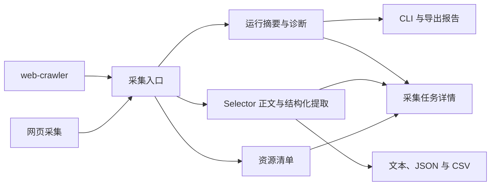
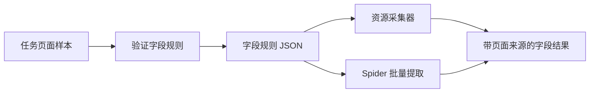

# 架构说明

`web-crawler` 采用分层架构：核心库（`src/web_crawler/`）+ 应用层（`src/web_crawler/app/`，随核心包分发）。
核心库对外暴露统一公开 API，所有重依赖（`playwright` / `curl_cffi` / `camoufox`）
均通过 `__getattr__` 懒加载，`import web_crawler` 不会强制加载任何可选依赖。

## 模块树

```
src/web_crawler/          # 核心库
  _types.py               # TextHandler / Attrs / ResultList
  compat.py               # 可选依赖探测（graceful degradation）
  response.py             # 统一 Response（selector helpers, meta, urljoin）
  crawler.py              # 同域异步爬虫（robots.txt 感知）
  parser/
    selector.py           # Selector + Adaptors（CSS/XPath/text/similarity/adaptive）
    adaptive.py           # compute_fingerprint + similarity_score + best_match
    storage.py            # AdaptiveStorage（线程安全 SQLite 存指纹）
    visual.py             # VisualExtractor（PixelRAG 风格截图瓦片 VLM）
  fetchers/
    _base.py              # BaseFetcher（共享配置 + response 构建）
    fetcher.py            # Fetcher + AsyncFetcher（curl_cffi TLS 隐身, httpx 兜底, JA3 定制）
    dynamic.py            # DynamicFetcher（Playwright JS 渲染）
    stealthy.py           # StealthyFetcher（反爬 / Cloudflare）
    camoufox.py           # CamoufoxFetcher（抗指纹 Firefox）
    proxy.py              # ProxyPool（轮换 + 冷却）
  spider/
    spider.py             # Spider + Request + SpiderStats（暂停/续跑）
    static_replay.py      # 静态轨迹 → 离线 Spider 项目（契约隔离 + 幂等）
  ai/                     # AI 辅助抓取 + JS 逆向套件
    llm.py                # LLMProvider（OpenAI 兼容，默认 DeepSeek）
    extractor.py          # AIExtractor（CSS 选择器生成 + 自愈）
    agent.py              # AIScrapeAgent（robots 感知礼貌爬虫）
    hooks.py              # JS Hook 库（fetch/XHR/cookie/crypto/webpack/console）
    analyzer.py           # JSAnalyzer（webpack 模块抽取 + AI 反混淆）
    captcha.py            # CaptchaManager（检测 + 仅人类化处理）
    image_captcha.py     # ImageCaptchaSolver（OCR / slider 缺口 / click 点选，LLM Vision + ddddocr/Pillow 降级）
    reverse_agent.py      # ReverseAgent（observe→think→act 循环）
    planner.py            # Planner/Actor 双脑分离 + 周期重规划
    loop.py               # LoopDetector + ContextCompressor（循环检测 + 历史压缩）
    judge.py              # TaskJudge（done 二次验证，防止 LLM 幻觉）
    watchdog.py           # EventBus + Heartbeat + CrashRecovery（崩溃自愈）
    recorder.py           # RunRecorder（成功路径编译为确定性脚本）
    schema.py             # SchemaValidator（结构化抽取 Pydantic 校验）
    dom_pruner.py         # DomPruner（DOM 焦点裁剪，Skyvern/browser-use 风格）
    checkpoint.py         # CheckpointManager（断点续跑 + 状态持久化）
    confidence.py         # ConfidenceScorer（动作置信度评分，规则 + LLM 双路径）
    guardrails.py         # ActionGuard（危险动作护栏，白名单 + 跨域拦截）
  pentest/                # 轻量渗透辅助工具集（纯 Python，无外部命令依赖）
    port_scanner.py       # PortScanner（TCP connect 扫描，TOP-100 端口）
    dir_bruter.py         # DirBruter（目录/文件路径爆破）
    subdomain.py          # SubdomainEnumerator（DNS 子域名枚举）
    vuln_scanner.py       # VulnScanner（SQLi/XSS/路径穿越规则检测）
    header_check.py       # HeaderChecker（8 项 HTTP 安全头检测 + A-F 评级）
    report.py             # PentestReport（聚合所有结果 + summary/to_dict/to_json）
  mcp/                    # MCP server + CLI
    server.py             # ReverseMCPServer（JSON-RPC over stdio）
    cli.py                # web-crawler-reverse 命令行
  py.typed                # PEP 561 类型标记
src/web_crawler/app/       # 应用层（随核心包分发）
  crawler.py              # 资源下载器（CLI / 主流程 / 网络编排，续传、去重、UI 驱动）
  crawler_models.py       # 共享数据类 Resource / ManifestRow
  crawler_net.py          # 网络/解析/工具层（限速、去重、URL 分类、HTML 解析）
  crawler_report.py       # 报告/格式层（清单、摘要、MD/HTML 报告、HTML 重写、智能抽取）
  db.py                   # SQLite 持久化（任务 + 结果，线程安全）
  ui.py                   # 本地 Web UI（SSE 实时推送）
  static/
    index.html            # UI 前端模板（运行时读取）
tests/                    # pytest 测试套件
benchmarks.py             # 解析器/fetcher 微基准 + 内置基线 + 回归检测
mkdocs.yml                # API 文档站点配置
```

## 各层职责

### 核心库 `src/web_crawler/`

#### 解析层 `parser/`

- **`Selector`** 基于 `lxml` + `cssselect`，对齐 Scrapling `Adaptor` API：
  - `css` / `css_first` / `xpath` / `xpath_first` / `re` / `re_first`
  - `find_by_regex` / `get_all_text` / `prettify`
  - 完整 DOM 遍历：`parent` / `children` / `siblings` / `next` / `previous` / `path`
- **`AdaptiveStorage`** 线程安全 SQLite，持久化元素指纹
- **`compute_fingerprint`** 把元素结构特征编码为可比较向量
- **`similarity_score`** 比较两指纹相似度，用于站点改版后重定位

#### 抓取层 `fetchers/`

- **`Fetcher`** 主力 HTTP fetcher：`curl_cffi` 重放真实浏览器 TLS/JA3 指纹与 HTTP/2 帧序
  - 支持 `impersonate="chrome131"` 等浏览器预设
  - **JA3 指纹定制**：`ja3_fingerprint` 参数透传到 `curl_cffi` 的 `ja3` 参数，
    覆盖预设的 TLS 扩展顺序，做细粒度 TLS 指纹定制
  - `curl_cffi` 缺失时自动降级到 `httpx`（带 warning，无指纹能力）
- **`AsyncFetcher`** 纯异步 fetcher，与 `Fetcher` 共享配置但只暴露 async 方法
- **`DynamicFetcher`** Playwright/Chromium 渲染，按选择器等待，按资源类型屏蔽
- **`StealthyFetcher`** 反爬专用：注入指纹补丁 JS、人类化鼠标/滚动，处理 Cloudflare
- **`CamoufoxFetcher`** 抗指纹 Firefox（Camoufox + Playwright），用于 JS 逆向 Agent
- **`ProxyPool`** 轮询/随机代理池，失败冷却

#### Spider 层 `spider/`

- **`Spider`** 回调驱动爬虫框架：
  - 优先级调度、域名过滤、URL 去重
  - JSON 状态序列化，支持暂停/续跑
  - `Request` 封装 URL + callback + meta
- **`StaticReplayCompiler`**：把成功静态 GET 导航快照与 CSS 抽取轨迹编译为独立离线
  Spider 项目。非 GET、缺少响应快照、选择器录制歧义及浏览器/LLM/验证码动作在
  编译期明确失败；缓存由 `CacheMiddleware(offline=True)` 提供，秘密值在落盘前脱敏，
  指纹重定位低于阈值、缺字段或类型错误的 item 写入 quarantine 而不进入 feed，
  重复离线运行按确定性 item 哈希幂等跳过。

#### AI 层 `ai/`

##### LLM 基础

- **`LLMProvider`** Protocol，OpenAI 兼容 chat-completions 接口
- **`DeepSeekProvider`** 默认 provider，指向 DeepSeek-V4.1-Flash
- **`OpenAIProvider`** OpenAI 官方预置
- 仅依赖 `httpx`，无额外 SDK

##### AI 抽取

- **`AIExtractor`** 自然语言 schema → CSS 选择器，带自愈
- **`AIScrapeAgent`** fetch + extract 编排，遵守 robots.txt、429/503 退避

##### JS 逆向 Agent

- **`ReverseAgent`** observe→think→act 主循环
- **`HookLibrary`** 6 个 JS Hook：fetch / XHR / cookie / `crypto.subtle` / webpack / console
- **`JSAnalyzer`** webpack 模块抽取、签名流追踪、AI 反混淆与算法重写
- **`CaptchaManager`** 检测 Turnstile / hCaptcha / reCAPTCHA v2&v3 / 极验 GeeTest；仅模拟正常用户

##### 主流 Agent 能力对齐

下列模块对齐 browser-use / Skyvern / PentAGI / LangGraph 等生产级 Agent 框架：
均通过 `ReverseAgentConfig` 字段单独开关。

| 能力 | 模块 | 作用 |
| --- | --- | --- |
| DOM 焦点裁剪 | `DomPruner` | 规则 + LLM 重排，仅保留加密相关元素（≈80% token 削减） |
| 断点续跑 | `CheckpointManager` | 步末状态持久化；崩溃/中断后从最近 checkpoint 恢复 |
| 动作置信度 | `ConfidenceScorer` | 规则 + LLM 双路径评分；低置信触发 fallback |
| 动作护栏 | `ActionGuard` | 域名白名单，拦截 localhost/非 HTTPS/跨域/危险脚本 |
| Planner/Actor 分离 | `Planner` | 高层子目标规划 + 周期重规划 |
| 循环检测 | `LoopDetector` | 页面状态指纹；重复状态自动重规划 |
| 上下文压缩 | `ContextCompressor` | 历史滚动摘要；超出 `max_history` 时自动压缩 |
| 任务裁决 | `TaskJudge` | 独立 LLM 验证 `done`，防幻觉成功 |
| 成功路径录制 | `RunRecorder` | 把成功 trace 编译为确定性 Python 脚本 |
| 事件总线 + 看门狗 | `watchdog` | 发布/订阅事件、心跳卡死检测、浏览器崩溃自愈 |
| 结构化 schema | `SchemaValidator` | Pydantic 结果校验 + 自动修复提示 |

##### 浏览器交互与多标签页

- 6 个真实 Playwright 动作：`click` / `type` / `scroll` / `press` / `hover` / `select_option`
- 3 个多标签页动作：`new_tab` / `switch_tab` / `close_tab`，维护 `name → page` 映射
- **人类化输入轨迹**：`humanize_input=True` 时
  - `click` 先 `hover` 移动鼠标，随机延迟 50–200 ms 后再点击
  - `type` 先 `focus`，思考停顿 100–300 ms，再用 `delay=30–150ms` 逐键输入

### 应用层 `src/web_crawler/app/`

- **`crawler.py`** 是 CLI 和 Web UI 共用的资源采集入口，负责编排扫描、下载、提取和报告。
- **`_crawler_post.py`** 复用解析层的 `Selector`。正文和结构化提取共享同一个 DOM，分别写出原有的文本、JSON 和 CSV 文件。
- **`_ui_runner.py`** 按任务保存页面提取结果，并将运行摘要和资源清单一起写入 SQLite。`db.py` 通过任务 ID 和来源 URL 关联页面与资源，输出目录可在多次运行之间复用。
- **`ui.py`** 提供本地工作台。任务概览显示各面板的运行状态，采集任务详情汇集诊断、日志、资源与页面提取内容。



**`parser/rules.py`** 定义版本化的 CSS/XPath 字段规则。控制台用任务中保留的 HTML 验证规则，资源采集器在提取阶段把同一结果写入 `rule_items.jsonl`，`web-crawler-startproject --rules` 生成的 Spider 将同一结构交给 feed 管道。每条结果用 `page_url` 记录来源。



控制台导出的采集配置可交给 `web-crawler --load-config` 使用。输出目录和页面样本保留由当前任务决定。页面样本按任务 ID 和 URL 保存在 SQLite，复用磁盘输出目录后仍可验证原任务的内容。

## 单模型策略

`ReverseAgent` 与所有子组件共享同一个 `DeepSeekProvider(model="deepseek-flash")` 实例。
不存在按组件路由模型、不存在 LLM-as-judge 重排、不存在能力协商切换 provider。

## 数据流

```
                ┌─────────────────────────────────────────┐
                │              ReverseAgent.run            │
                │  ┌─────────────────────────────────┐    │
                │  │   1. observe(page) → Observation │   │
                │  │      - hook_data (JS 注入捕获)    │   │
                │  │      - network_requests           │   │
                │  │      - scripts / dom_summary      │   │
                │  └────────────┬────────────────────┘    │
                │               ▼                          │
                │  ┌─────────────────────────────────┐    │
                │  │   2. think(observation) → Action │   │
                │  │      LLM 决定下一步动作           │   │
                │  │      Guard 校验 / Confidence 评分 │   │
                │  └────────────┬────────────────────┘    │
                │               ▼                          │
                │  ┌─────────────────────────────────┐    │
                │  │   3. act(page, action)           │   │
                │  │      - click/type/scroll/...     │   │
                │  │      - new_tab/switch_tab/...    │   │
                │  │      - inject_hook/analyze_js    │   │
                │  └────────────┬────────────────────┘    │
                │               ▼                          │
                │   LoopDetector / Judge                 │
                │   循环到 done 或 max_steps               │
                └─────────────────────────────────────────┘
```
